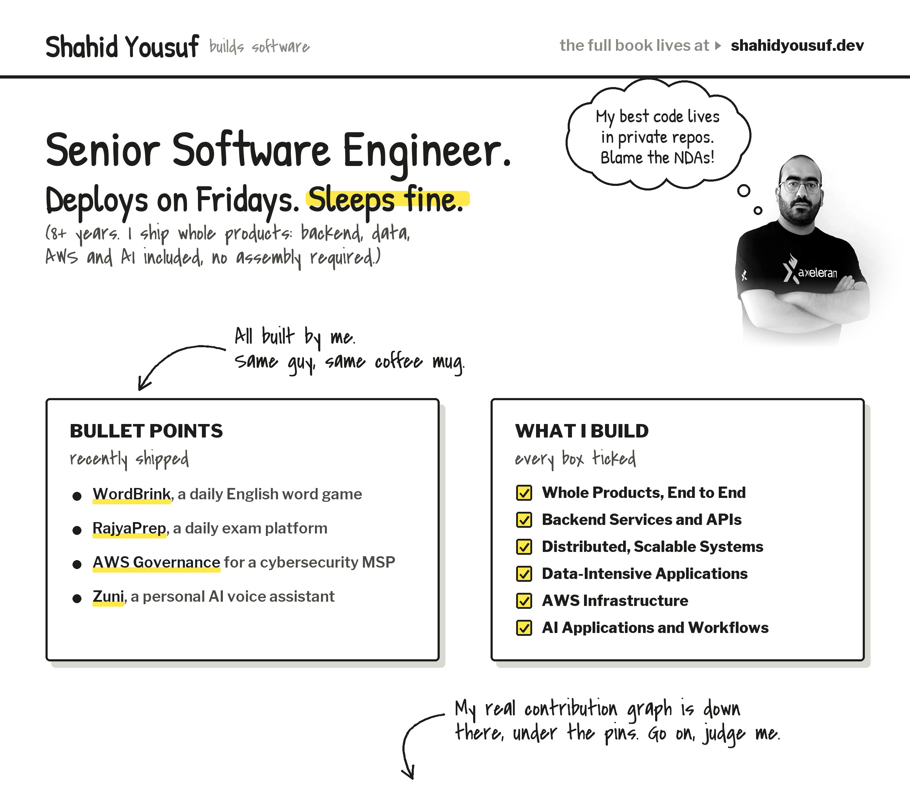
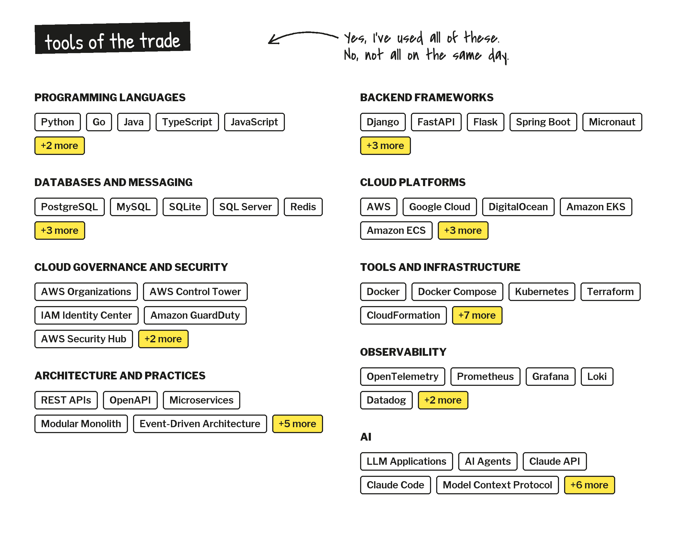
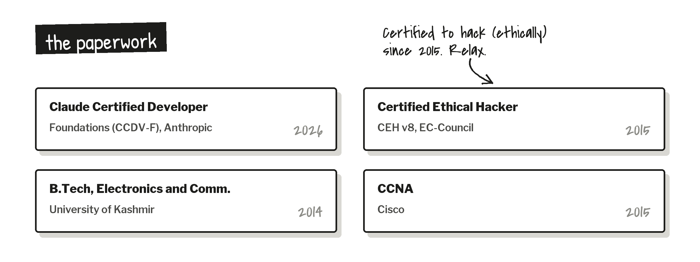

🌐 **[shahidyousuf.dev](https://shahidyousuf.dev)** is the full book: the blog, case studies, and a free intro call if you'd like to work together.

<b>Every tool, in full</b> (the "+N more" chips, unfolded)

<!-- skills:start -->
**Programming Languages**

&nbsp; &nbsp; &nbsp; &nbsp; &nbsp; &nbsp; 

**Backend Frameworks**

&nbsp; &nbsp; &nbsp; &nbsp; &nbsp; &nbsp; &nbsp; 

**Databases and Messaging**

&nbsp; &nbsp; &nbsp; &nbsp; &nbsp; &nbsp; &nbsp; 

**Cloud Platforms**

&nbsp; &nbsp; &nbsp; &nbsp; &nbsp; &nbsp; &nbsp; 

**Cloud Governance and Security**

&nbsp; &nbsp; &nbsp; &nbsp; &nbsp; &nbsp; 

**Tools and Infrastructure**

&nbsp; &nbsp; &nbsp; &nbsp; &nbsp; &nbsp; &nbsp; &nbsp; &nbsp; &nbsp; &nbsp; 

**Observability**

&nbsp; &nbsp; &nbsp; &nbsp; &nbsp; &nbsp; 

**Architecture and Practices**

&nbsp; &nbsp; &nbsp; &nbsp; &nbsp; &nbsp; &nbsp; &nbsp; &nbsp; 

**AI**

&nbsp; &nbsp; &nbsp; &nbsp; &nbsp; &nbsp; &nbsp; &nbsp; &nbsp; &nbsp; 
<!-- skills:end -->

---

Drawn by hand, well, by a script, in the style of [shahidyousuf.dev](https://shahidyousuf.dev). Last updated November 2026.
